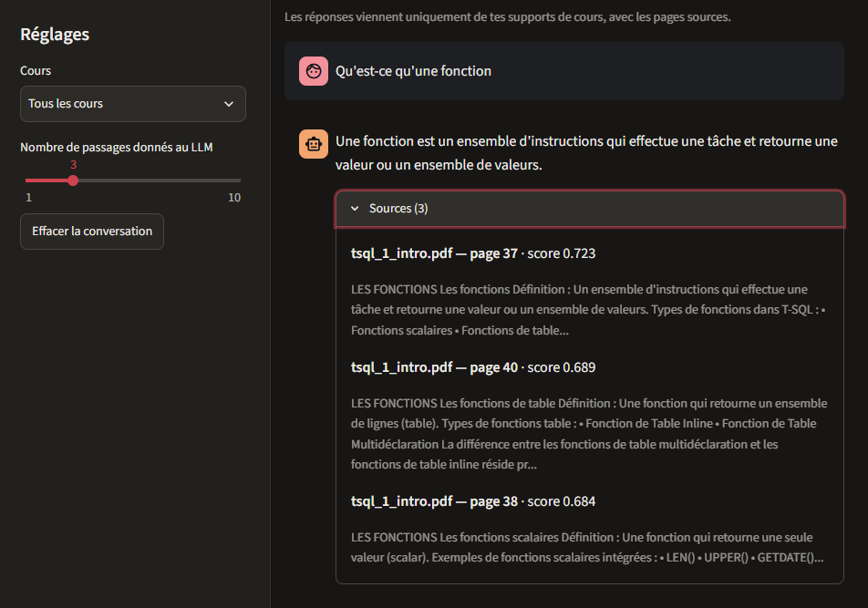
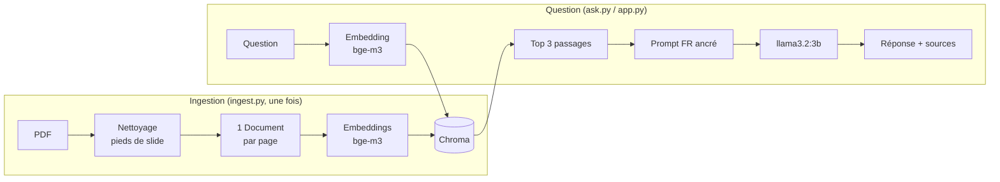

# RAG Course Assistant

Assistant de révision qui répond aux questions sur mes supports de cours (PDF) en **citant le fichier et la page** de chaque réponse. Tout tourne **en local** : aucun document ne quitte l'ordinateur.



## Résultats

Évaluation sur un jeu de test de **34 questions** écrites à partir de 2 cours (traitement automatique du langage et T-SQL, 193 pages) :

| Métrique | Résultat |
| --- | --- |
| Hit rate@1 (bonne page en 1re position) | 97 % (31 / 32) |
| Hit rate@3 (bonne page parmi les 3 passages donnés au LLM) | **100 %** (32 / 32) |
| MRR@5 | **0,984** |
| Question hors cours | Le modèle répond « Je ne trouve pas cette information dans le cours » au lieu d'inventer |

Les 32 questions notées couvrent 5 types : définitions, détails précis, différences entre deux notions, **reformulations** (aucun mot commun avec la slide) et une question piège présente dans les deux cours. Les 2 questions hors cours servent à vérifier les hallucinations.

**Avant / après :** sans RAG, le LLM définit « processus » au sens général ; avec RAG, il reprend la définition exacte du cours et cite la page.

## Architecture



## Stack

| Couche | Outil |
| --- | --- |
| Langage | Python |
| Framework RAG | LlamaIndex |
| Modèles locaux | Ollama : `bge-m3` (embeddings multilingues, 1024 dimensions), `llama3.2:3b` (génération) |
| Base vectorielle | Chroma (persistante, distance cosinus) |
| Lecture des PDF | PyMuPDF |
| Interface | Streamlit |

## Installation

Prérequis : Python 3.11+ et [Ollama](https://ollama.com/download).

```bash
ollama pull bge-m3
ollama pull llama3.2:3b

git clone <url-du-depot>
cd rag-course-assistant
python -m venv .venv
.venv\Scripts\activate          # Linux / Mac : source .venv/bin/activate
pip install -r requirements.txt

python test_setup.py            # vérifie les deux modèles
```

Placer ses PDF dans un dossier par matière (le nom du dossier sert de filtre) :

```
data/raw/
├── nlp/
└── tsql/
```

Les PDF de cours ne sont pas publiés dans ce dépôt (`data/raw/` est ignoré par Git).

## Utilisation

```bash
python ingest.py                                  # lit les PDF et remplit Chroma
python ask.py "Qu'est-ce que la lemmatisation ?"  # une question en ligne de commande
streamlit run app.py                              # interface web (http://localhost:8501)
python evaluate.py                                # mesure la recherche sur eval/questions.json
python evaluate.py --llm                          # + vérifie les questions hors cours
python mesurer_pages.py                           # taille des pages en tokens
```

## Choix techniques

- **Nettoyage avant indexation.** Les slides répètent sur chaque page le nom du module, de l'enseignante, une date et un numéro (≈ 7 % du texte d'une page). Ces lignes sont supprimées pour ne pas rendre toutes les pages artificiellement similaires.
- **1 page = 1 chunk.** Les pages font en moyenne 118 tokens et au plus 360 ; avec `chunk_size = 512`, aucune n'est coupée. Chaque chunk correspond à une unité de sens préparée par l'enseignant, et la citation de page est toujours exacte.
- **Embeddings multilingues.** `bge-m3` a été choisi car les cours sont en français.
- **Prompt ancré.** Le modèle doit répondre en français, uniquement à partir des extraits, et dire explicitement quand l'information n'est pas dans le cours.
- **Évaluer la recherche séparément du LLM.** `evaluate.py` mesure si la bonne page est retrouvée, sans appeler le LLM : quelques secondes par run, ce qui permet de comparer chaque réglage.
- **Filtre par matière.** La métadonnée `course` permet de limiter la recherche à un cours dans l'interface.

## Limites connues

- Le code SQL des slides est en **images** : il n'est pas extrait, donc l'assistant explique les notions mais ne reproduit pas les exemples de code.
- Le jeu de test est presque saturé (97 à 100 %) : il est utile pour détecter une régression, moins pour départager deux bons réglages.
- Chaque question est traitée seule : l'interface affiche l'historique, mais le modèle n'a pas de mémoire de conversation.
- Les PDF scannés (sans texte) ne sont pas pris en charge.

## Pistes d'amélioration

- API FastAPI et conteneurisation Docker
- Recherche hybride (BM25 + vecteurs) et reranker
- Chat multi-tours et génération de quiz à partir d'un chapitre
- OCR pour les slides contenant du code en image

## Structure

```
├── config.py          # modèles Ollama utilisés par LlamaIndex
├── ingest.py          # PDF -> nettoyage -> chunks -> embeddings -> Chroma
├── ask.py             # question en ligne de commande, avec sources
├── app.py             # interface Streamlit
├── evaluate.py        # hit rate et MRR sur le jeu de test
├── mesurer_pages.py   # taille des pages en tokens
├── test_setup.py      # vérification de l'installation
├── voir_page.py       # visualiser le nettoyage d'une page
├── eval/questions.json
└── docs/demo.png
```

---

Projet personnel de Bechir Marweni, étudiant en dernière année de Génie Logiciel à la Faculté des Sciences de Tunis.
